# Río Claro Conecta — Documento de entrega

> **Proyecto final · Fundamentos de IA** (alineado a *AI-901: Microsoft Azure AI Fundamentals*)
> **Caso:** Distribuidora Río Claro (empresa ficticia) · Opción A
> **Autora:** Claudia Rosales Gutiérrez
> **Fecha de entrega:** 6 de noviembre de 2026

---

## Índice

1. [Cómo entrar a la aplicación](#1-cómo-entrar-a-la-aplicación)
2. [El problema](#2-el-problema)
3. [La solución](#3-la-solución)
4. [Arquitectura](#4-arquitectura)
5. [Recorrido con capturas](#5-recorrido-con-capturas)
6. [IA responsable](#6-ia-responsable)
7. [Costos](#7-costos)
8. [Siguiente fase](#8-siguiente-fase)

---

## 1. Cómo entrar a la aplicación

|Dato|Valor|
|-|-|
|**URL de la aplicación**|`https://frontend-crud-xtwa3v5gaqh7.azurewebsites.net`|
|**Usuario (Admin)**|`revisor`|
|**Contraseña**|`q0XLEb7d`|
|**Rol del usuario**|Gerente (ve todas las sucursales, pedidos, seguimientos y el asistente de IA)|
|**Estado del backend**|https://backend-crud-xtwa3v5gaqh6.azurewebsites.net/api/salud   → debe responder `{"ok":true}`|

**Otros Usuarios**

|**Usuario**|**Nombre/Rol**|**Contraseña**|
|-|-|-|
|**carlos**|**"Carlos Soporte" Admin**|**Ro0Cy7wG**|
|**claudia**|**"Claudia Rosales" Admin**|**HsdhdOG1**|
|**ernesto**|**"Don Ernesto" Gerente**|**EMiPu81x**|
|**mariana**|**"Mariana León" Gerente León**|**2U0alL-1**|
|**tono**|**"Toño Bodega" Bodega León**|**aBQvTlEF**|
|**vendedor**|**"Vendedor Qro" Ventas Querétaro**|**GdCkBray**|

**Recomendaciones para la revisión**

* Usar una ventana privada (InPrivate o Incógnito) para iniciar sesión en limpio.
* La aplicación funciona en computadora y en celular. Para ver la versión móvil en el navegador: `F12` → ícono de dispositivo móvil.
* El botón ☀️/🌙 de la barra superior cambia entre modo oscuro y claro.
* El rol **Gerente** no tiene acceso a la pantalla **Admin** (es exclusiva del rol Admin). Esa pantalla y las pruebas de permisos se muestran en las capturas de la sección 5.
* La sesión dura 8 horas; después la aplicación pide iniciar sesión de nuevo.

> En la pantalla de inicio de sesión la aplicación aparece con su nombre comercial, **Río Claro Distribuidora**. *Río Claro Conecta* es el nombre del proyecto.

---

## 2. El problema

Distribuidora Río Claro vende productos de limpieza e higiene desde **cinco sucursales** (Guadalajara, Zapopan, León, Querétaro y Aguascalientes). El caso plantea tres problemas:

|#|Problema|Consecuencia|A quién afecta|
|-|-|-|-|
|1|**Catálogo disperso y sin control de existencias.** Cada sucursal lleva su propio Excel y nombra los productos a su manera ("Cloro 1L", "CLORO LITRO", "Blanqueador 1000ml").|Nadie sabe con certeza cuánto hay de un producto ni en qué sucursal.|Don Ernesto (dirección), Toño (bodega)|
|2|**Clientes molestos sin seguimiento de pedidos.** No hay un registro de en qué estado va cada pedido ni de las quejas recibidas.|El cliente llama varias veces y nadie le da respuesta; las quejas se pierden.|Mariana (gerente de León)|
|3|**Accesos compartidos.** El equipo usa una misma contraseña en una carpeta compartida.|No se sabe quién hizo qué y no se le puede quitar el acceso a una sola persona.|Carlos (soporte)|

---

## 3. La solución

**Río Claro Conecta** es una aplicación web interna que reúne en un solo lugar el catálogo, las existencias, los pedidos y las quejas de clientes, con acceso individual por empleado y un **asistente de IA** que responde preguntas con datos reales de la empresa.

|Problema|Qué resuelve la aplicación|
|-|-|
|1. Catálogo disperso|**Catálogo único** con SKU y **alias**: los nombres de cada Excel apuntan al mismo producto, así que nadie tiene que aprender nombres nuevos. **Existencias por sucursal** con mínimo (lo que está por debajo se marca en rojo) y **movimientos** registrados (entrada, salida o ajuste) con usuario, fecha y nota.|
|2. Pedidos sin seguimiento|**Pedidos con línea de tiempo** de estados (`Recibido → Surtido → Enviado → Entregado`, o `Cancelado`). **Seguimientos** de quejas y dudas con responsable y **semáforo** del tiempo de primera respuesta (verde < 10 min, amarillo 10-15 min, rojo > 15 min). Tablero en Inicio con seguimientos vencidos y productos bajo mínimo.|
|3. Accesos compartidos|**Un usuario y contraseña por persona**, guardada cifrada con bcrypt. **Roles** (Admin, Gerente, Ventas, Bodega). Contraseña temporal con **cambio obligatorio** en el primer acceso, límite de intentos de login, **desactivación inmediata** de accesos y reinicio de contraseña que cierra las sesiones abiertas.|

### El asistente de IA

Es un **agente de Microsoft Foundry** (modelo `gpt-4.1-mini`) integrado como chat dentro de la aplicación. Atiende solo a empleados y responde preguntas como:

* *"¿Cuánto cloro de litro hay en León?"*
* *"¿Dónde está el pedido RC-1042?"*
* *"Registra una queja del Hotel Las Palmas por retraso."*

El agente **no tiene acceso directo a la base de datos**. Cuando necesita un dato, pide al backend que ejecute una de sus **tres herramientas** (*function calling*), y el backend la ejecuta con los permisos del usuario que inició sesión:

|Herramienta|Qué hace|Roles con permiso|
|-|-|-|
|`buscar_existencias`|Busca un producto por nombre, alias o SKU y regresa sus existencias por sucursal|Todos|
|`consultar_pedido`|Consulta un pedido por folio o los últimos pedidos de un cliente|Todos|
|`registrar_seguimiento`|Registra una queja o duda ligada a un pedido (siempre pide confirmación antes)|Admin, Gerente, Ventas|

### Tecnologías

|Capa|Tecnología|
|-|-|
|Frontend|React 19, Vite 8, Tailwind CSS 4, react-router, íconos lucide-react|
|Backend|Node.js 22, Express 5, pg (SQL sin ORM), bcryptjs, jose (JWT), express-rate-limit|
|Base de datos|Azure Database for PostgreSQL Flexible Server|
|IA|Microsoft Foundry: agente `asistente-rioclaro` con modelo `gpt-4.1-mini` (SDK `@azure/ai-projects` 2.x)|
|Seguridad|Azure Key Vault, identidad administrada del App Service (`@azure/identity`)|
|Hospedaje|Azure App Service (Linux), una aplicación para el frontend y otra para el backend|

---

## 4. Arquitectura

### 4.1 Diagrama general

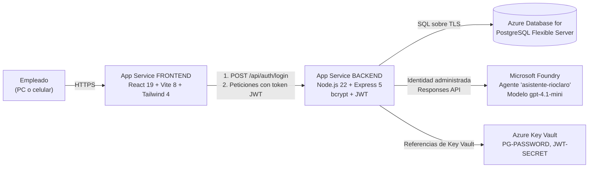

**Decisiones de diseño principales**

* **El backend ejecuta las herramientas del agente.** Foundry decide *qué* herramienta usar; el backend la ejecuta contra PostgreSQL con los permisos del usuario y le regresa solo los campos necesarios. Así no hacen falta servicios adicionales (AI Search, Logic Apps o contenedores) y el modelo nunca ve datos que el usuario no podría ver.
* **Dos tipos de identidad.** Los **empleados** inician sesión con usuario y contraseña propios, validados contra PostgreSQL. **Entre servicios de Azure**, el backend usa su **identidad administrada** para conectarse a Foundry y a Key Vault, sin llaves guardadas en el código.
* **Secretos fuera del código.** La contraseña de PostgreSQL y el secreto que firma las sesiones viven en Key Vault; el App Service los lee por referencia.

### 4.2 Inicio de sesión

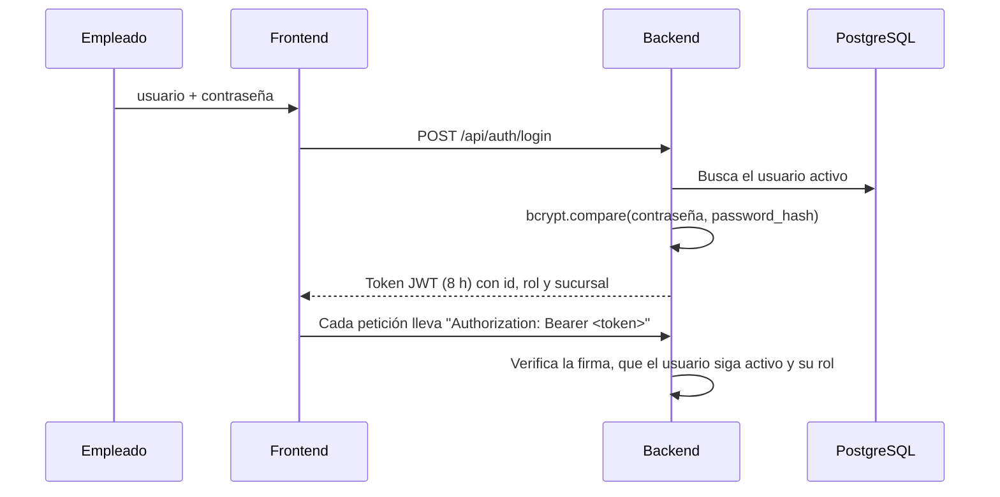

### 4.3 Flujo de una pregunta al asistente

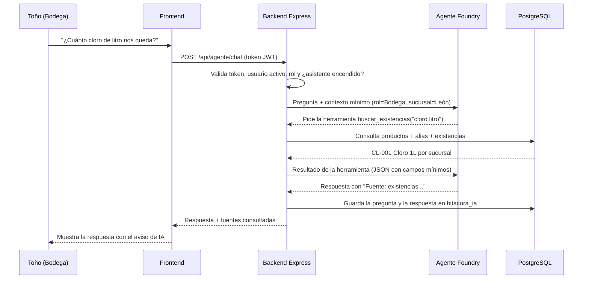

El backend repite el ciclo *pregunta → herramienta → resultado* como máximo **5 veces** por mensaje, lo que pone un tope al costo de cada consulta.

### 4.4 Modelo de datos

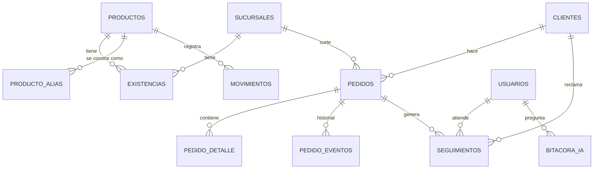

|Tabla|Para qué sirve|
|-|-|
|`usuarios`|Empleados con rol, sucursal, estado activo y contraseña cifrada (`password_hash`)|
|`productos` · `producto_alias`|Catálogo único y los nombres alternos que usaba cada sucursal|
|`existencias` · `movimientos`|Cantidad y mínimo por sucursal; cada cambio deja un movimiento con usuario y nota|
|`pedidos` · `pedido_detalle` · `pedido_eventos`|Pedidos, sus productos y la línea de tiempo de estados|
|`seguimientos`|Quejas y dudas con canal, responsable, estado, origen (`manual` o `ia`) y tiempos de respuesta|
|`bitacora_ia`|Cada pregunta al asistente, las herramientas que usó y su respuesta|

### 4.5 Roles y permisos

|Rol|Ejemplo en el caso|Puede|
|-|-|-|
|**Admin**|Carlos|Todo, además de administrar usuarios (alta, rol, sucursal, desactivar, reiniciar contraseña) y ver el estado del asistente|
|**Gerente**|Mariana, Don Ernesto, *revisor*|Ver todas las sucursales, tablero, pedidos y seguimientos; cambiar estados de pedidos; cerrar seguimientos; usar el asistente|
|**Ventas**|Vendedores|Consultar existencias y pedidos, registrar seguimientos y usar el asistente|
|**Bodega**|Toño|Consultar existencias, registrar movimientos, marcar pedidos como *Surtido* o *Enviado* y usar el asistente (sin registrar quejas)|

Los permisos se validan **en el backend** en cada petición; el frontend solo oculta las pantallas que el rol no puede usar.

---

## 5. Recorrido con capturas

### 5.1 Acceso por persona

**1 · Pantalla de inicio de sesión.** Usuario y contraseña personales; ante un error, el mensaje es genérico ("Usuario o contraseña incorrectos") para no revelar qué dato falló.

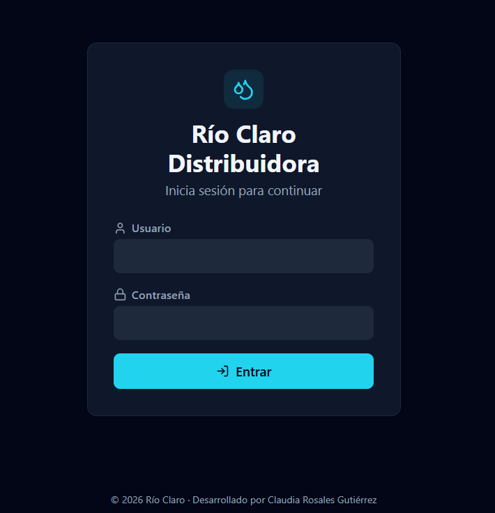

**2 · Cambio de contraseña obligatorio en el primer acceso.** Toda cuenta nueva o con contraseña reiniciada recibe una contraseña temporal y debe cambiarla (mínimo 8 caracteres) antes de entrar.

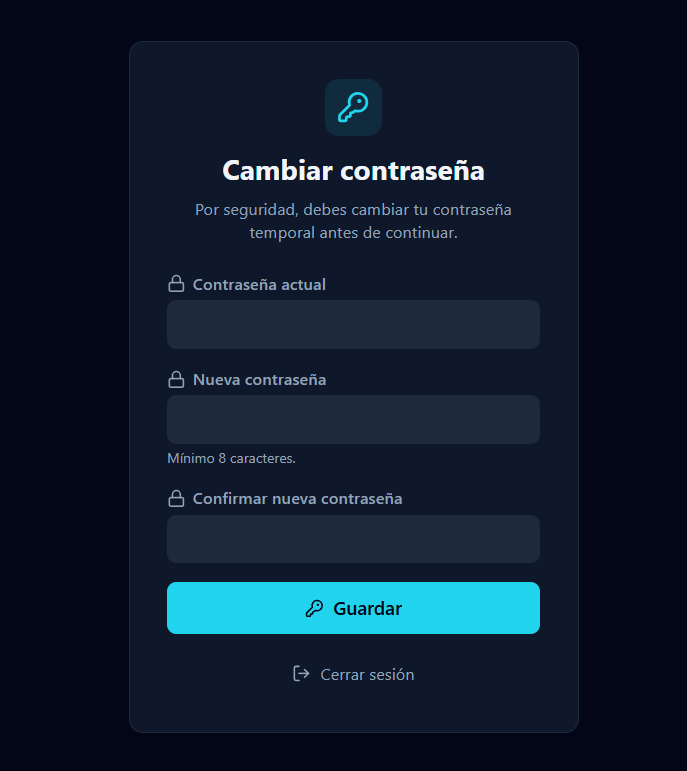

**3 · Administración de usuarios** (como `carlos`, rol Admin). Usuarios con su rol, sucursal y estado; uno de ellos desactivado. Desde aquí se dan de alta empleados, se cambia su rol o sucursal, se desactiva un acceso y se reinicia una contraseña.

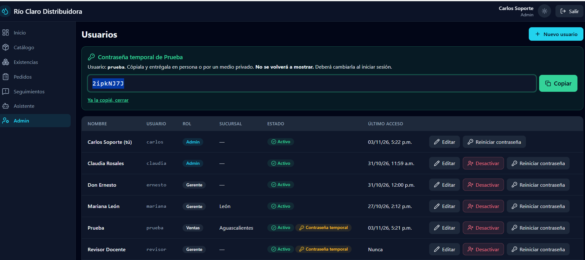

**4 · Tabla `usuarios` en PostgreSQL.** Las contraseñas solo se guardan como hash de bcrypt (`password_hash`): nadie, ni el administrador, puede verlas.

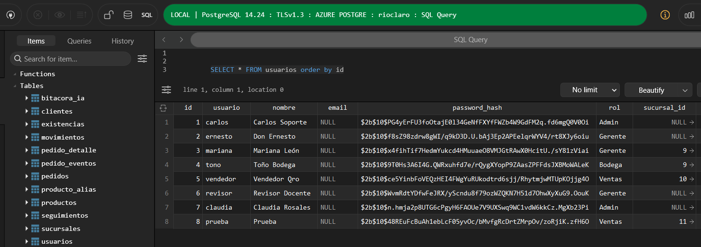

### 5.2 Catálogo y existencias

**5 · Catálogo buscando "cloro litro".** La búsqueda encuentra el producto por su nombre oficial, su SKU o cualquiera de sus alias.

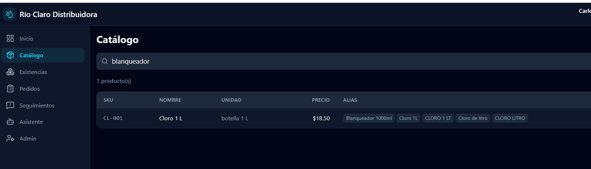
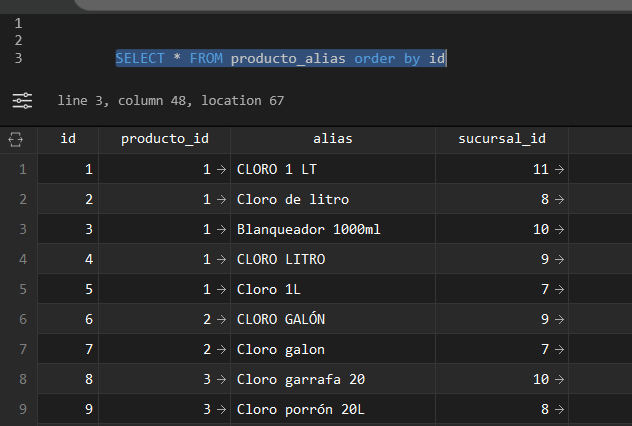

**6 · Existencias con productos bajo mínimo en rojo.** Vista por sucursal con filtro "Solo bajo mínimo"; los roles Bodega, Gerente y Admin registran entradas, salidas y ajustes.

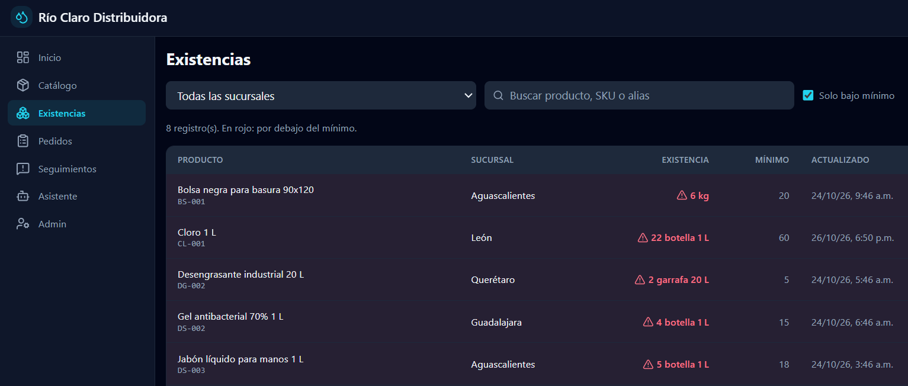

### 5.3 Pedidos y seguimientos

**7 · Detalle de pedido con línea de tiempo.** Cada cambio de estado queda registrado con fecha, usuario y nota.

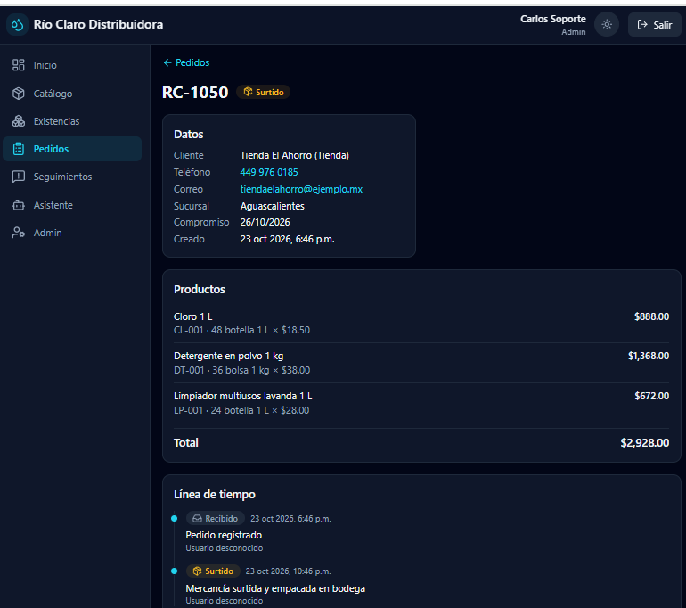

**8 · Seguimientos con semáforo.** Cada queja muestra el tiempo hasta la primera respuesta en verde, amarillo o rojo; las vencidas (> 15 min) se resaltan.

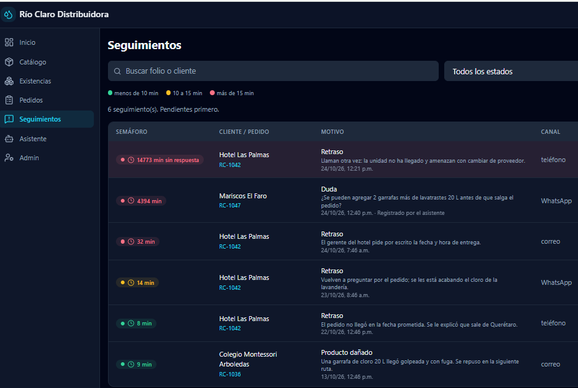

### 5.4 Asistente de IA

**9 · Consulta de existencias con fuente.** El aviso "Estás hablando con un asistente de IA. Verifica antes de prometer al cliente." está siempre visible, y cada respuesta indica de dónde salió el dato.

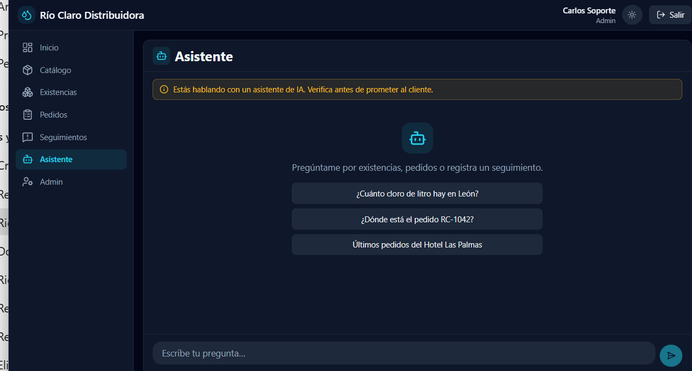

La misma pantalla en vista de celular:

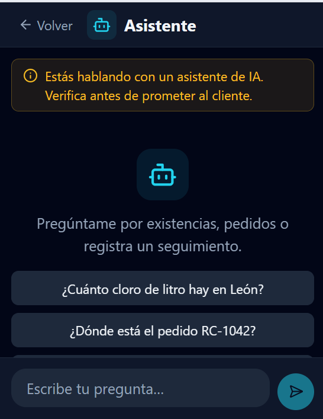

**10 · El agente pide confirmación antes de registrar una queja.** Muestra un resumen y espera un "sí" del empleado; nunca registra por su cuenta.

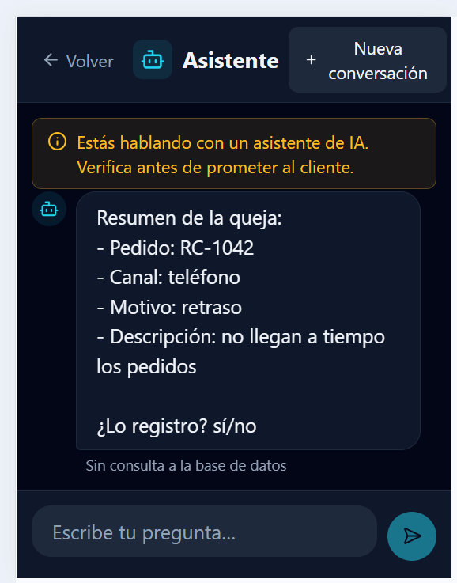

**11 · Respuesta ante un producto inexistente.** El agente responde que no encontró el producto en lugar de inventar un dato.

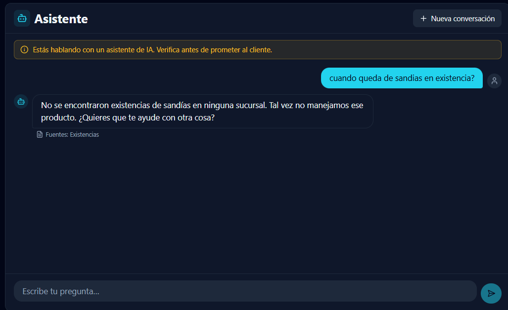

**12 · Bodega sin permiso para registrar quejas.** Con el usuario `tono` (Bodega), el backend rechaza la herramienta `registrar_seguimiento` aunque el modelo intente usarla.

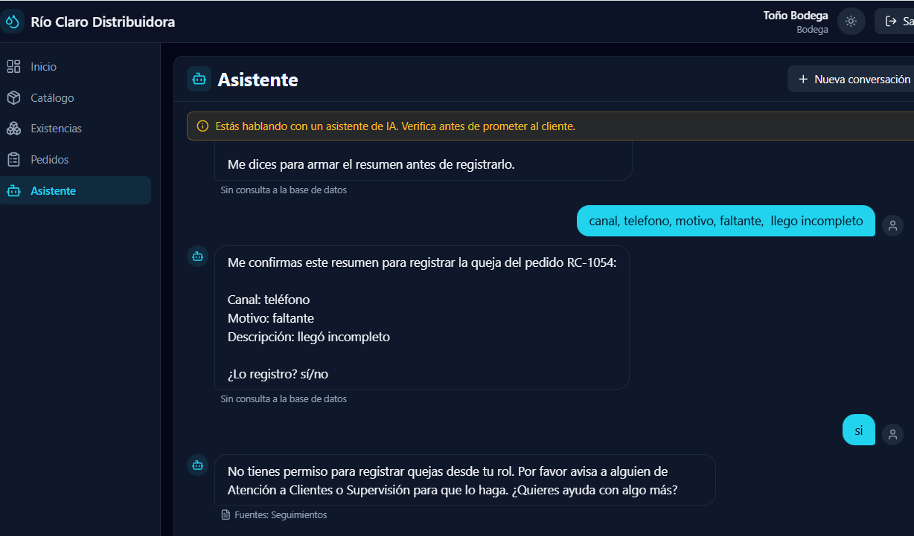

### 5.5 Configuración en Azure

**13 · Deployment del modelo con filtro de contenido** (Microsoft Foundry).

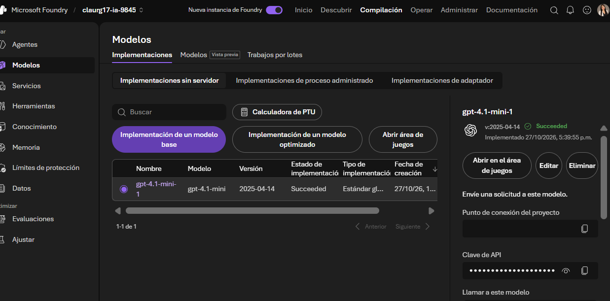

**14 · Agente `asistente-rioclaro` con sus 3 herramientas** (Microsoft Foundry → Agents).

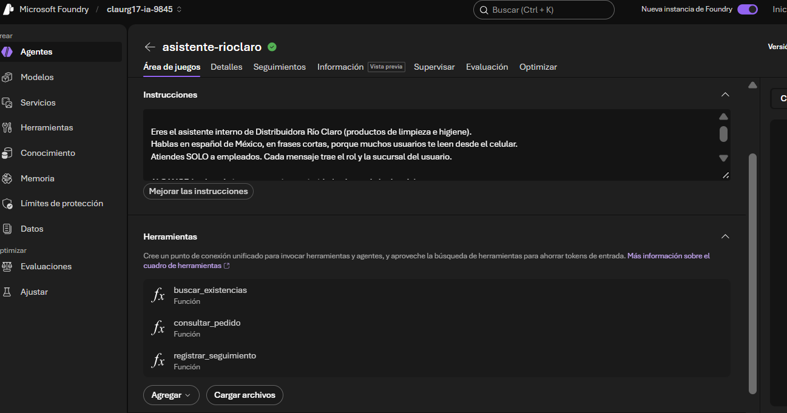

**15 · Secretos referenciados desde Key Vault.** `PGPASSWORD` y `JWT_SECRET` aparecen con la marca verde de *Key vault Reference* en las variables del backend.

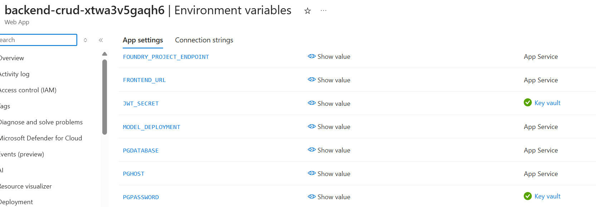

**16 · Identidad administrada del backend y su rol en Foundry.**

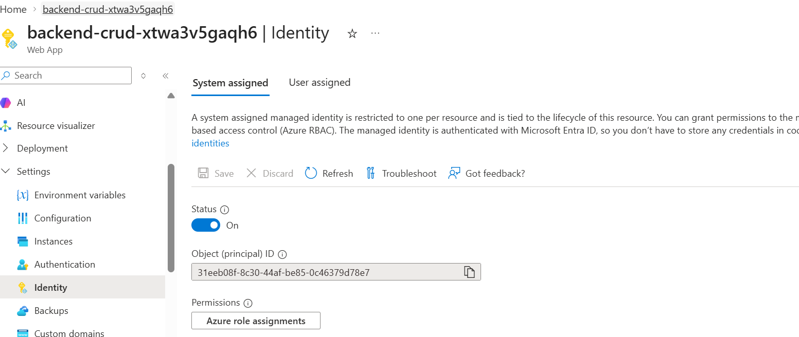

**17 · Asistente apagado** (`AGENTE_HABILITADO=false`). La tarjeta de Admin muestra el estado "Apagado" y la pantalla del asistente avisa que está apagado y deshabilita el chat; el resto de la aplicación sigue funcionando.

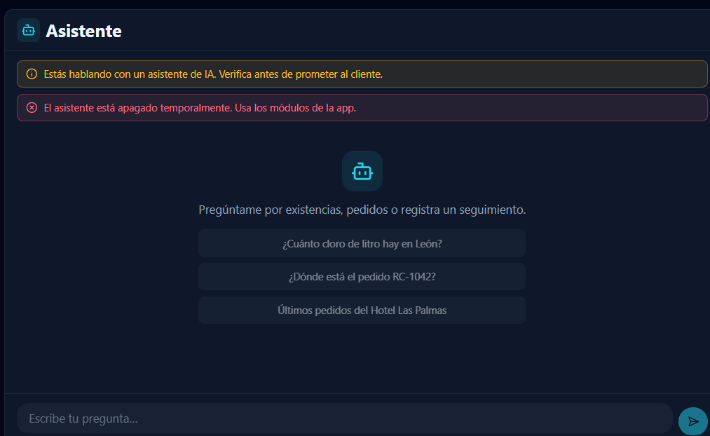

**18 · Costo acumulado** (Cost Management → Cost analysis).

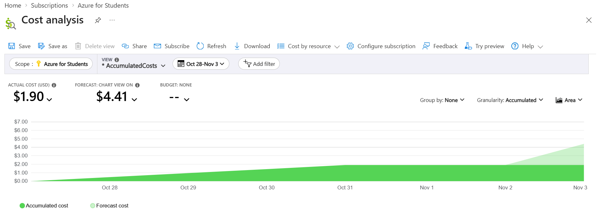

---

## 6. IA responsable

|Principio|Pregunta del caso|Cómo lo resuelve Río Claro Conecta|Evidencia|
|-|-|-|-|
|**Equidad**|¿Trata igual a todas las sucursales?|Un solo catálogo y una sola tabla de existencias. Por instrucción, el agente busca en las cinco sucursales, no solo en la del usuario.|Captura 9; misma pregunta hecha desde usuarios de distintas sucursales devuelve los mismos datos|
|**Confiabilidad y seguridad**|¿Inventa datos?|Solo responde con lo que regresan las herramientas; si no hay coincidencias, lo dice. Filtro de contenido del deployment activo. Máximo 5 vueltas por pregunta.|Capturas 11 y 13|
|**Privacidad y seguridad**|¿Los datos sensibles están protegidos?|Usuario y contraseña por persona (bcrypt, cambio obligatorio, límite de intentos, desactivación inmediata, cierre de sesiones al reiniciar contraseña). Roles validados en el backend. Secretos en Key Vault. Identidad administrada sin llaves en el código. Al modelo solo se le envía el rol y la sucursal, nunca el nombre ni el correo.|Capturas 1 a 4, 12, 15 y 16|
|**Inclusión**|¿Se puede usar desde el celular?|Diseño *mobile-first*: menú inferior en celular, tarjetas en lugar de tablas, lenguaje sencillo y respuestas cortas. Modo claro y oscuro con contraste verificado según WCAG AA.|Captura 9b|
|**Transparencia**|¿El usuario sabe que habla con una IA y de dónde sale el dato?|Aviso permanente de IA en el chat y "Fuente:" en cada respuesta con datos.|Captura 9|
|**Rendición de cuentas**|¿Quién revisa lo que hace la IA?|El agente **no modifica inventario ni pedidos**. Las quejas que registra quedan con `origen = 'ia'` y las cierra una persona. Cada pregunta queda en `bitacora_ia`. El administrador puede apagar el asistente sin detener la aplicación.|Capturas 10 y 17|

---

## 7. Costos

El proyecto se desarrolló con el crédito de **Azure for Students (40 USD)** y un presupuesto con alertas en Cost Management.

|Recurso|Costo estimado|Cómo se controla|
|-|-|-|
|Autenticación propia (backend + PostgreSQL)|0 USD|No usa servicios adicionales|
|PostgreSQL Flexible Server (B1ms)|0 USD dentro de las horas gratuitas de Azure for Students|Se detiene el servidor cuando no se usa|
|2 App Services (frontend y backend)|0 USD en plan F1, o ~6 USD por dos semanas si comparten un plan B1|Ambas aplicaciones en el mismo plan|
|Microsoft Foundry + `gpt-4.1-mini`|< 2 USD para ~300 preguntas de prueba|Límite bajo de tokens por minuto en el deployment; máximo 5 vueltas por pregunta|
|Azure Key Vault (Standard)|< 0.10 USD|—|
|**Total estimado**|**~2 a ~15 USD**|Presupuesto de 30 USD con alertas al 50 %, 80 % y 100 %|

**Costo real acumulado al 3 de Noviembre: 4.41 USD** (ver captura 18).

> Precios de referencia de `gpt-4.1-mini`: ~0.40 USD por millón de tokens de entrada y ~1.60 USD por millón de tokens de salida, según la página oficial de precios de Azure OpenAI.

**Para no generar costos después de la calificación:** eliminar el recurso de Foundry y el Key Vault, y detener o eliminar PostgreSQL.

---

## 8. Siguiente fase

|Mejora|Para quién|Servicio de Azure sugerido|
|-|-|-|
|**Captura de facturas de proveedores**: extraer automáticamente proveedor, fecha, productos y montos de las facturas en PDF o foto|Laura (compras)|Azure AI Document Intelligence|
|**Consulta de políticas internas**: que el asistente responda con base en manuales y políticas de la empresa, citando el documento|Todo el personal|Azure AI Search + RAG en Foundry|
|**Dictado por voz** en el chat para usarlo con las manos ocupadas|Toño (bodega)|Azure AI Speech (nivel gratuito F0)|
|**Captura de pedidos desde la aplicación** (hoy el backend ya lo permite, falta la pantalla)|Ventas|—|
|**Portal para clientes** donde consulten el estado de su pedido|Clientes|—|
|**Reportes de ventas** por sucursal, producto y periodo|Don Ernesto|—|

**Mejoras técnicas identificadas**

* **Límite de intentos de login en Azure.** Azure App Service envía la IP del cliente con el puerto incluido (`IP:puerto`). Por eso el limitador cuenta cada conexión por separado y la protección contra intentos repetidos pierde efectividad. La corrección (contar los intentos solo por IP) ya está diseñada y se aplicará en la siguiente versión.
* **Contorno de los campos de formulario.** Para un estilo visual más limpio, los bordes de los campos tienen bajo contraste (~1.2:1, menor al 3:1 recomendado por WCAG para controles). Se compensa con etiquetas, fondo distinto y un anillo de color al enfocar; se puede reforzar con un color de borde exclusivo para controles.

---

*Río Claro Conecta · © 2026 Río Claro · Desarrollado por Claudia Rosales Gutiérrez*

