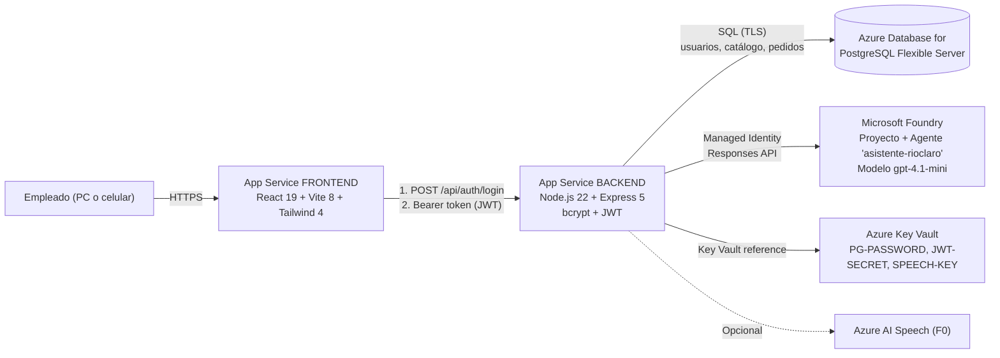
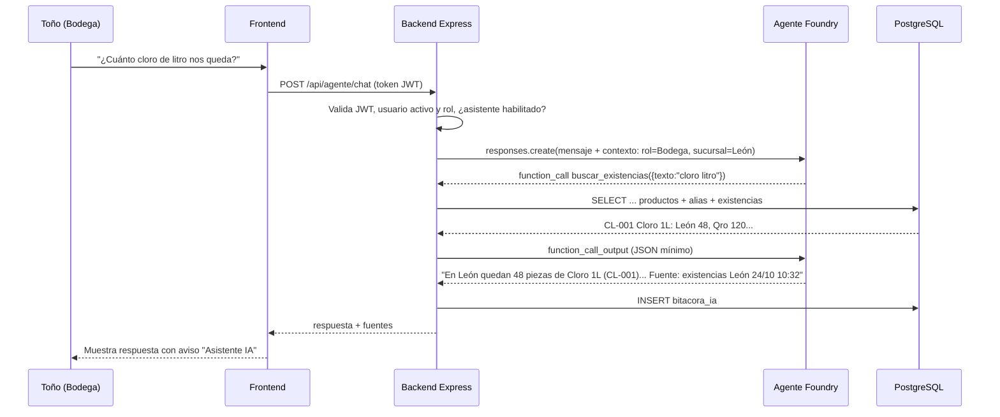
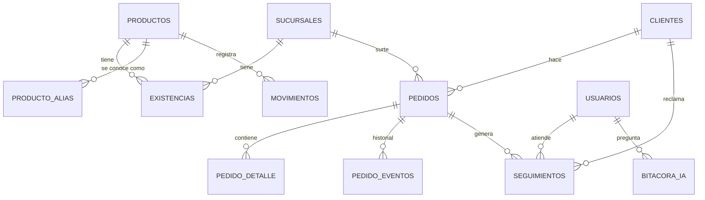
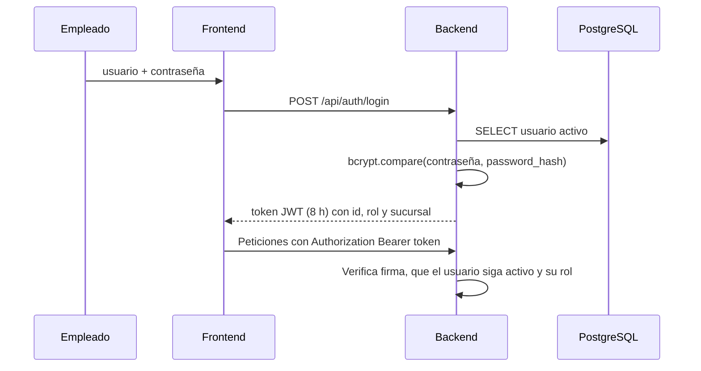

# Río Claro Conecta — Definición, arquitectura y plan de implementación

> Proyecto final · Fundamentos de IA (alineado a **AI-901: Microsoft Azure AI Fundamentals**)
> Caso: Distribuidora Río Claro (empresa ficticia) · Opción A
> Entrega: viernes 6 de noviembre de 2026, 23:45 (hora del centro de México, GMT-6)

---

## 1. Resumen en una línea

**Río Claro Conecta** es una aplicación web interna con **un solo catálogo y control de existencias**, **seguimiento de pedidos y quejas de clientes**, **acceso por persona con usuario y contraseña propios (validados contra PostgreSQL)** y un **asistente de IA (agente de Microsoft Foundry)**. El asistente responde en segundos preguntas como *"¿cuánto cloro de litro nos queda en León?"* o *"¿dónde está el pedido RC-1042 del Hotel Las Palmas?"*.

| Problema del caso | Qué resuelve la app | Personaje beneficiado |
|---|---|---|
| 1. Catálogo disperso y sin control de existencias | Catálogo único con **SKU + alias** ("Cloro 1L", "CLORO LITRO" y "Blanqueador 1000ml" apuntan al mismo producto) y existencias por sucursal con movimientos registrados | Don Ernesto, Toño |
| 2. Clientes molestos sin seguimiento de pedidos | Pedidos con **línea de tiempo de estados** y **seguimientos (quejas)** con responsable, semáforo de 15 min e historial | Mariana |
| 3. Accesos por persona | **Un usuario y contraseña por empleado** guardados en PostgreSQL (contraseña cifrada con **bcrypt**), **roles** (Admin, Gerente, Ventas, Bodega), sesión con **JWT**, desactivación de accesos, secretos en **Key Vault** y **botón de apagado** del asistente | Carlos |

---

## 2. Definición de la aplicación (alcance mínimo)

### 2.1 Usuarios y roles (tabla `usuarios` en PostgreSQL)

| Rol | Ejemplo | Puede |
|---|---|---|
| `Admin` | Carlos (soporte) | Todo, además de administrar el catálogo, asignar sucursales a usuarios y apagar el asistente |
| `Gerente` | Mariana (León), Don Ernesto | Ver todas las sucursales, ver pedidos y seguimientos, cerrar seguimientos y usar el asistente |
| `Ventas` | Vendedores | Crear pedidos, registrar seguimientos y consultar existencias y pedidos |
| `Bodega` | Toño | Consultar existencias, registrar entradas y salidas, cambiar el estado de los pedidos a "Surtido" o "Enviado" y usar el asistente (solo para inventario) |

> El agente **solo atiende a empleados**. Los clientes siguen llamando, pero cualquier empleado contesta en menos de 15 minutos, sin importar de qué sucursal salió el pedido.

### 2.2 Funcionalidades (MVP)

**Módulo Catálogo y existencias**
- Catálogo único: SKU, nombre oficial, unidad, precio de venta y activo/inactivo.
- Alias por producto: los nombres "viejos" de cada Excel de sucursal, para que nadie tenga que aprender nombres nuevos.
- Existencias por sucursal, con su mínimo; se resalta en rojo lo que está por debajo del mínimo.
- Movimientos (entrada, salida o ajuste) con usuario, fecha y nota. Nunca se edita la existencia "a mano" sin dejar rastro.
- Importación inicial desde los Excel/CSV de las 5 sucursales (script de un solo uso).

**Módulo Pedidos y seguimiento**
- Pedido con folio (`RC-0001`), cliente, sucursal que surte, productos y fecha compromiso.
- Estados: `Recibido → Surtido → Enviado → Entregado` (o `Cancelado`). Cada cambio crea un **evento** en la línea de tiempo.
- **Seguimientos (quejas y dudas)**: se registran contra el pedido o el cliente, con canal (teléfono, WhatsApp o correo), motivo, responsable y estado (`Abierto`, `En proceso` o `Cerrado`).
- Semáforo de tiempo de **primera respuesta**: verde (< 10 min), amarillo (10-15 min) y rojo (> 15 min).
- Historial por cliente: así se ve que "el hotel reclamó 4 veces por el mismo retraso".

**Módulo Accesos**
- Inicio de sesión con **usuario y contraseña personales** (se acabó la contraseña compartida de la carpeta).
- Tabla `usuarios` con usuario, nombre, **rol**, sucursal, `activo` y la contraseña **cifrada con bcrypt** (nunca en texto plano).
- Al validar la contraseña, el backend entrega un **token JWT** firmado (expira en 8 horas) con el id, el rol y la sucursal. Cada petición a la API lo envía.
- Contraseña temporal al crear el usuario y **cambio obligatorio en el primer inicio de sesión** (mínimo 8 caracteres).
- Límite de intentos de login (10 cada 15 minutos por IP) y mensaje genérico "Usuario o contraseña incorrectos".
- Pantalla **Admin** (solo Carlos): alta de usuarios, cambio de rol o sucursal, **desactivar acceso** y reiniciar contraseña.
- Bitácora: quién movió inventario, quién cambió el estado de un pedido y qué se le preguntó al asistente.

**Asistente IA (agente de Foundry)**
- Chat dentro de la app, con el aviso **"Estás hablando con un asistente de IA. Verifica antes de prometer al cliente."**
- Consulta **datos reales** con herramientas (function calling): busca productos y existencias, consulta pedidos y registra seguimientos (siempre pide confirmación antes).
- Cada respuesta indica **de dónde salió el dato** (por ejemplo, "Fuente: existencias de León, actualizado 24/10 10:32").
- Si no encuentra el dato, **lo dice**; no inventa cifras.
- *(Opcional)* Botón de micrófono para Toño con **Azure AI Speech** (nivel gratuito F0).

### 2.3 Fuera de alcance (por ahora)
Facturas de proveedores (Laura), políticas internas (RAG sobre documentos), portal para clientes y reportes de ventas avanzados. Se mencionan como **siguiente fase** en el documento de entrega.

### 2.4 Historias de usuario clave (para probar y para las capturas)
1. *Como Toño*, pregunto "¿cuánto cloro de litro nos queda?" y obtengo la existencia correcta de mi sucursal y de las demás.
2. *Como Mariana*, un cliente llama por el pedido RC-1042; en la app (o preguntando al asistente) veo que salió de Querétaro, en qué estado está y registro un seguimiento en menos de 2 minutos.
3. *Como Don Ernesto*, veo en Inicio los seguimientos abiertos y vencidos (>15 min) y los productos bajo mínimo de las 5 sucursales.
4. *Como Carlos*, doy de alta a un empleado nuevo en la pantalla Admin con su rol y sucursal, desactivo el acceso de quien ya no trabaja ahí y apago el asistente si algo falla.

---

## 3. Arquitectura

### 3.1 Diagrama general



### 3.2 Componentes y por qué

| Componente | Servicio Azure | Uso | Reutilizas |
|---|---|---|---|
| Frontend | App Service (Linux, Node 22) | Sirve el build de React (SPA) | Sí |
| Backend | App Service (Linux, Node 22) | API REST + orquesta el agente y ejecuta sus herramientas | Sí |
| Base de datos | Azure Database for PostgreSQL Flexible Server | Catálogo, existencias, pedidos, seguimientos, usuarios, bitácora | Sí |
| Autenticación de usuarios | Propia en el backend (bcryptjs + JWT) con la tabla `usuarios` de PostgreSQL | Login por persona y roles | Sí (sin costo extra) |
| IA | Microsoft Foundry (recurso + proyecto) + Foundry Agent Service | Agente "prompt agent" con herramientas de función | Nuevo (pago por token) |
| Secretos | Azure Key Vault (Standard) | Contraseña de PostgreSQL, secreto para firmar los JWT y llaves | Nuevo (centavos) |
| Voz (opcional) | Azure AI Speech F0 | Dictado para bodega | Nuevo (gratis) |

**Decisión clave para ahorrar:** el agente **no tiene acceso directo a la base de datos**. Foundry decide *qué* herramienta llamar; el **backend la ejecuta** con los permisos del usuario que inició sesión y regresa solo los campos necesarios. Así no se necesita AI Search, Logic Apps ni contenedores extra, y se cumple con *privacidad y seguridad*.

**Sobre la identidad:** los **empleados** inician sesión con usuario y contraseña de la base de datos (no se usa Entra ID para personas). Entre servicios de Azure sí se usa la **Identidad Administrada** del backend (que funciona sobre Entra ID de forma automática y sin configuración de usuarios) para conectarse a Foundry y a Key Vault sin guardar llaves en el código.

### 3.3 Flujo de una pregunta al asistente



### 3.4 Modelo de datos



```sql
-- db/001_esquema.sql
CREATE TABLE sucursales (id SERIAL PRIMARY KEY, nombre TEXT UNIQUE NOT NULL);

CREATE TABLE usuarios (
  id SERIAL PRIMARY KEY,
  usuario TEXT UNIQUE NOT NULL,             -- nombre de inicio de sesión en minúsculas, ej. "mariana"
  nombre TEXT NOT NULL, email TEXT,
  password_hash TEXT NOT NULL,              -- hash bcrypt; NUNCA la contraseña en texto plano
  rol TEXT NOT NULL CHECK (rol IN ('Admin','Gerente','Ventas','Bodega')),
  sucursal_id INT REFERENCES sucursales(id),
  activo BOOLEAN NOT NULL DEFAULT TRUE,     -- Carlos puede desactivar un acceso
  debe_cambiar_password BOOLEAN NOT NULL DEFAULT TRUE,
  ultimo_acceso TIMESTAMPTZ, creado_en TIMESTAMPTZ DEFAULT now()
);

CREATE TABLE productos (
  id SERIAL PRIMARY KEY, sku TEXT UNIQUE NOT NULL, nombre TEXT NOT NULL,
  unidad TEXT NOT NULL, precio_venta NUMERIC(10,2), activo BOOLEAN DEFAULT TRUE
);
CREATE TABLE producto_alias (
  id SERIAL PRIMARY KEY, producto_id INT NOT NULL REFERENCES productos(id),
  alias TEXT NOT NULL, sucursal_id INT REFERENCES sucursales(id)
);
CREATE TABLE existencias (
  producto_id INT REFERENCES productos(id), sucursal_id INT REFERENCES sucursales(id),
  cantidad INT NOT NULL DEFAULT 0, minimo INT NOT NULL DEFAULT 0,
  actualizado_en TIMESTAMPTZ DEFAULT now(), PRIMARY KEY (producto_id, sucursal_id)
);
CREATE TABLE movimientos (
  id SERIAL PRIMARY KEY, producto_id INT NOT NULL REFERENCES productos(id),
  sucursal_id INT NOT NULL REFERENCES sucursales(id),
  tipo TEXT CHECK (tipo IN ('entrada','salida','ajuste')), cantidad INT NOT NULL,
  usuario_id INT REFERENCES usuarios(id), nota TEXT, creado_en TIMESTAMPTZ DEFAULT now()
);

CREATE TABLE clientes (id SERIAL PRIMARY KEY, nombre TEXT NOT NULL, telefono TEXT, email TEXT, tipo TEXT);
CREATE TABLE pedidos (
  id SERIAL PRIMARY KEY, folio TEXT UNIQUE NOT NULL, cliente_id INT REFERENCES clientes(id),
  sucursal_id INT REFERENCES sucursales(id),
  estado TEXT CHECK (estado IN ('Recibido','Surtido','Enviado','Entregado','Cancelado')) DEFAULT 'Recibido',
  fecha_compromiso DATE, creado_en TIMESTAMPTZ DEFAULT now()
);
CREATE TABLE pedido_detalle (
  pedido_id INT REFERENCES pedidos(id), producto_id INT REFERENCES productos(id),
  cantidad INT NOT NULL, precio NUMERIC(10,2), PRIMARY KEY (pedido_id, producto_id)
);
CREATE TABLE pedido_eventos (
  id SERIAL PRIMARY KEY, pedido_id INT REFERENCES pedidos(id), estado TEXT, nota TEXT,
  usuario_id INT REFERENCES usuarios(id), creado_en TIMESTAMPTZ DEFAULT now()
);
CREATE TABLE seguimientos (
  id SERIAL PRIMARY KEY, pedido_id INT REFERENCES pedidos(id), cliente_id INT REFERENCES clientes(id),
  canal TEXT, motivo TEXT, descripcion TEXT,
  estado TEXT CHECK (estado IN ('Abierto','En proceso','Cerrado')) DEFAULT 'Abierto',
  asignado_a INT REFERENCES usuarios(id), creado_por INT REFERENCES usuarios(id),
  origen TEXT CHECK (origen IN ('manual','ia')) DEFAULT 'manual',
  creado_en TIMESTAMPTZ DEFAULT now(), primera_respuesta_en TIMESTAMPTZ, cerrado_en TIMESTAMPTZ
);
CREATE TABLE bitacora_ia (
  id SERIAL PRIMARY KEY, usuario_id INT REFERENCES usuarios(id), pregunta TEXT,
  herramientas TEXT[], respuesta TEXT, creado_en TIMESTAMPTZ DEFAULT now()
);
```

Datos de prueba sugeridos: 5 sucursales, ~30 productos (con los alias del caso: "Cloro 1L", "CLORO LITRO" y "Blanqueador 1000ml" → `CL-001`), 15 clientes (hoteles, restaurantes, escuelas), 25 pedidos en distintos estados y 6 seguimientos (uno de ellos con 4 quejas del mismo hotel).

### 3.5 API del backend (Express 5)

| Método y ruta | Roles | Descripción |
|---|---|---|
| `GET /api/salud` | público | Health check |
| `POST /api/auth/login` | público (con límite de intentos) | `{ usuario, password }` → `{ token, usuario }` |
| `POST /api/auth/cambiar-password` | todos | `{ actual, nueva }` (obligatorio en el primer acceso) |
| `GET /api/me` | todos | Usuario, rol y sucursal |
| `GET /api/usuarios` · `POST /api/usuarios` · `PATCH /api/usuarios/:id` | Admin | Alta (con contraseña temporal), cambio de rol o sucursal, activar o desactivar |
| `POST /api/usuarios/:id/reiniciar-password` | Admin | Genera una nueva contraseña temporal |
| `GET /api/productos?q=` | todos | Busca por nombre, SKU o alias |
| `POST /api/productos` · `PUT /api/productos/:id` | Admin | Alta y edición de catálogo |
| `GET /api/existencias?sucursal=` | todos | Existencias, con bandera de bajo mínimo |
| `POST /api/movimientos` | Bodega, Gerente, Admin | Entrada, salida o ajuste (transacción: movimiento + existencia) |
| `GET /api/pedidos?estado=&sucursal=` · `GET /api/pedidos/:folio` | Ventas, Gerente, Admin, Bodega | Lista y detalle con línea de tiempo |
| `POST /api/pedidos` | Ventas, Gerente | Crear pedido |
| `PATCH /api/pedidos/:folio/estado` | Bodega, Gerente | Cambia el estado y crea un evento |
| `GET/POST /api/seguimientos` · `PATCH /api/seguimientos/:id` | Ventas, Gerente, Admin | Quejas y dudas |
| `GET /api/tablero` | Gerente, Admin | KPIs para Inicio |
| `POST /api/agente/chat` | todos | `{ mensaje, conversacionId }` → `{ texto, fuentes, conversacionId }` |
| `GET /api/voz/token` *(opcional)* | todos | Token temporal de Speech (la llave nunca llega al navegador) |

### 3.6 Pantallas del frontend
`Login` (usuario y contraseña) · `Cambiar contraseña` · `Inicio (tablero)` · `Catálogo` · `Existencias` · `Pedidos` (lista + detalle con línea de tiempo) · `Seguimientos` · `Asistente` (chat; en el celular es la pantalla principal para Bodega) · `Admin` (usuarios: alta, rol, sucursal, desactivar y reiniciar contraseña; estado del asistente). El diseño es *mobile-first* con Tailwind, para que Toño y los vendedores la usen desde el celular.

### 3.7 Estructura del repositorio

```
rioclaro-conecta/
├── backend/
│   ├── src/
│   │   ├── app.js               # Express 5, CORS, rutas
│   │   ├── db.js                # Pool de pg (SSL)
│   │   ├── auth.js              # Firma y valida el JWT propio + requireRole
│   │   ├── rutas/               # auth, usuarios, productos, existencias, pedidos, seguimientos, agente
│   │   └── agente/
│   │       ├── instrucciones.js
│   │       ├── herramientas.js  # Definición JSON de las funciones
│   │       ├── ejecutor.js      # Ejecuta cada función contra PostgreSQL
│   │       └── servicio.js      # Bucle Responses API + function calling
│   ├── scripts/crear-agente.mjs # Crea o actualiza el agente en Foundry
│   ├── scripts/crear-usuario.mjs# Crea usuarios con contraseña temporal (el primer Admin)
│   ├── db/001_esquema.sql, 002_datos.sql
│   └── package.json
└── frontend/
    ├── src/ (auth/AuthContext.jsx, api.js, paginas/, componentes/)
    ├── vite.config.js
    └── package.json
```

---

## 4. Presupuesto (crédito disponible: 40 USD)

| Recurso | Costo estimado durante el proyecto (~2 semanas) | Cómo controlarlo |
|---|---|---|
| Autenticación propia (backend + PostgreSQL) | 0 | — |
| PostgreSQL Flexible **B1ms** (ya existe) | 0 si está dentro de las 750 h/mes gratis de Azure for Students (12 meses); si no, ~6-7 USD | **Detén el servidor** cuando no trabajes (`az postgres flexible-server stop`) |
| 2 App Services | 0 en plan **F1**; ~6 USD por 2 semanas si comparten **un** plan B1 | Revisa que **ambas apps estén en el mismo plan** (pagas el plan, no la app) |
| Foundry + **gpt-4.1-mini** (Global Standard) | < 2 USD (~300 preguntas de prueba ≈ 2.4 M tokens de entrada + 0.12 M de salida) | Límite de TPM bajo (10K) en el deployment |
| Key Vault Standard | < 0.10 | — |
| Speech F0 (opcional) | 0 | Nivel gratuito |
| **Total esperado** | **~2 USD (mejor caso) a ~15 USD (peor caso)** | **Crea un presupuesto de 30 USD** en Cost Management con alertas al 50%, 80% y 100% |

> Precios de referencia de gpt-4.1-mini: ~0.40 USD por 1M de tokens de entrada y ~1.60 USD por 1M de salida. Confírmalos en la página oficial de precios de Azure OpenAI antes de empezar. **No** crees Azure AI Search, Application Insights con mucho volumen, contenedores ni el modo "Standard agent setup" (crea Cosmos DB y Storage propios); usa el **Basic agent setup**.

---

## 5. Plan de trabajo (24 oct → 6 nov)

| Días | Fecha | Entregable del día |
|---|---|---|
| 1 | Sáb 24 oct | Presupuesto y alertas de costo; definir usuarios de prueba, roles y permisos |
| 2 | Dom 25 oct | Esquema SQL + datos de prueba en PostgreSQL (incluye la normalización de alias del catálogo) |
| 3-4 | 26-27 oct | Backend: conexión a la BD, login (bcrypt + JWT), alta de usuarios, rutas de catálogo, existencias y movimientos |
| 5 | 28 oct | Backend: pedidos, eventos, seguimientos y tablero |
| 6-7 | 29-30 oct | Frontend: login y cambio de contraseña, layout, Catálogo, Existencias, Pedidos, Seguimientos y Admin de usuarios |
| 8 | 31 oct | Foundry: recurso, proyecto, deployment del modelo y pruebas en el playground |
| 9 | 1 nov | Agente con herramientas + `/api/agente/chat` + pantalla Asistente |
| 10 | 2 nov | Despliegue a Azure: Managed Identity, Key Vault y variables de entorno |
| 11 | 3 nov | Pruebas de extremo a extremo y pruebas de IA responsable (sección 7); *opcional:* voz |
| 12 | 4 nov | Usuario "revisor" para el docente, ajustes de UX en el celular y switch de apagado |
| 13 | 5 nov | Documento Markdown de entrega con capturas |
| 14 | 6 nov | Revisión final y **entrega antes de las 23:45** (deja margen; no lo dejes para la noche) |

---

## 6. Paso a paso

### Paso 0 — Preparación (una sola vez)
1. Instala Node.js **22 LTS** (el SDK `@azure/ai-projects` 2.x lo requiere), Azure CLI, VS Code y su extensión *Azure App Service*.
2. `az login` y selecciona tu suscripción de estudiante: `az account set --subscription "<id>"`.
3. **Presupuesto:** Portal → *Cost Management* → *Budgets* → 30 USD, con alertas a tu correo.
4. Revisa tus App Services: *Runtime* = **Node 22 LTS** (Linux) y el *pricing tier* del plan.

### Paso 1 — Accesos por persona (usuarios en la base de datos)

**Cómo funciona el login**



**Reglas de seguridad mínimas**
- Las contraseñas se guardan con **bcrypt** (librería `bcryptjs`, costo 10). Nadie, ni Carlos, puede ver una contraseña.
- El token JWT se firma con un secreto largo (`JWT_SECRET`) que en Azure vive en **Key Vault**.
- El token **expira en 8 horas** (un turno de trabajo).
- En cada petición se revisa que el usuario siga `activo`, así que si Carlos desactiva un acceso, se corta de inmediato.
- Hay un límite de 10 intentos de login cada 15 minutos por IP (`express-rate-limit`).
- La contraseña temporal se debe cambiar en el primer acceso, con un mínimo de 8 caracteres.

**Usuarios de prueba** (se crean con `scripts/crear-usuario.mjs`, que genera una contraseña temporal):

| usuario | Nombre | Rol | Sucursal |
|---|---|---|---|
| `carlos` | Carlos Soporte | Admin | — |
| `ernesto` | Don Ernesto | Gerente | — |
| `mariana` | Mariana León | Gerente | León |
| `tono` | Toño Bodega | Bodega | León |
| `vendedor` | Vendedor Qro | Ventas | Querétaro |
| **`revisor`** | Revisor Docente | Gerente | — |

El usuario **`revisor`** es el que le darás al docente para entrar "como usuario normal". Cambia su contraseña temporal por una que compartas en la entrega.

`scripts/crear-usuario.mjs`
```js
import "dotenv/config";
import bcrypt from "bcryptjs";
import crypto from "node:crypto";
import { pool } from "../src/db.js";

const [usuario, nombre, rol, sucursal] = process.argv.slice(2);
if (!usuario || !nombre || !rol) {
  console.log('Uso: node scripts/crear-usuario.mjs <usuario> "<Nombre>" <Admin|Gerente|Ventas|Bodega> [Sucursal]');
  process.exit(1);
}
const temporal = crypto.randomBytes(6).toString("base64url"); // contraseña temporal aleatoria
await pool.query(
  `INSERT INTO usuarios (usuario, nombre, rol, sucursal_id, password_hash)
   VALUES ($1, $2, $3, (SELECT id FROM sucursales WHERE nombre = $4), $5)`,
  [usuario.toLowerCase(), nombre, rol, sucursal ?? null, await bcrypt.hash(temporal, 10)]
);
console.log(`Usuario ${usuario} creado. Contraseña temporal: ${temporal}`);
await pool.end();
```

### Paso 2 — Base de datos (PostgreSQL existente)
1. *Networking*: deja marcado **"Allow public access from any Azure service"** y agrega tu IP.
2. Crea la base: `CREATE DATABASE rioclaro;`
3. Ejecuta `db/001_esquema.sql` y `db/002_datos.sql` (con `psql`, pgAdmin o la extensión PostgreSQL de VS Code).
4. **Normalización del catálogo (problema 1):** junta los Excel de las 5 sucursales en un CSV `sucursal, nombre_original, existencia`. Asigna a cada fila un SKU del catálogo oficial y carga `nombre_original` en `producto_alias`. *(Punto extra de IA: usa el playground de Foundry para pedir que agrupe los nombres que parecen el mismo producto, y **tú** confirmas los grupos. Así se ve que la IA sugiere y la persona decide.)*

### Paso 3 — Backend (Node 22 + Express 5)

```bash
cd backend
npm init -y && npm pkg set type=module
npm i express@5 cors pg jose bcryptjs express-rate-limit dotenv @azure/ai-projects @azure/identity
```

`.env` (local; en Azure van en *Environment variables*):
```
PORT=3000
PGHOST=<servidor>.postgres.database.azure.com
PGUSER=<admin>
PGPASSWORD=<solo local; en Azure viene de Key Vault>
PGDATABASE=rioclaro
JWT_SECRET=<cadena aleatoria de 64 caracteres; en Azure viene de Key Vault>
FRONTEND_URL=http://localhost:5173
FOUNDRY_PROJECT_ENDPOINT=https://<recurso>.services.ai.azure.com/api/projects/<proyecto>
MODEL_DEPLOYMENT=gpt-4.1-mini
AGENT_NAME=asistente-rioclaro
AGENTE_HABILITADO=true
```

`src/db.js`
```js
import pg from "pg";
export const pool = new pg.Pool({ ssl: true }); // lee PGHOST, PGUSER, etc. del entorno
```

`src/auth.js` — firma y valida el token propio, y revisa roles
```js
import { SignJWT, jwtVerify } from "jose";
import { pool } from "./db.js";

const SECRETO = new TextEncoder().encode(process.env.JWT_SECRET);

export async function firmarToken(u) {
  return new SignJWT({ nombre: u.nombre, rol: u.rol, sucursal_id: u.sucursal_id })
    .setProtectedHeader({ alg: "HS256" })
    .setSubject(String(u.id))
    .setIssuedAt()
    .setExpirationTime("8h")
    .sign(SECRETO);
}

export async function requireAuth(req, res, next) {
  try {
    const token = req.headers.authorization?.split(" ")[1];
    const { payload } = await jwtVerify(token, SECRETO);
    // Si Carlos desactivó al usuario, se corta el acceso aunque el token no haya expirado
    const { rows: [u] } = await pool.query("SELECT activo FROM usuarios WHERE id = $1", [payload.sub]);
    if (!u?.activo) throw new Error("inactivo");
    req.user = { id: Number(payload.sub), nombre: payload.nombre, rol: payload.rol, sucursal_id: payload.sucursal_id };
    next();
  } catch {
    res.status(401).json({ error: "Sesión inválida o expirada" });
  }
}
export const requireRole = (...roles) => (req, res, next) =>
  roles.includes(req.user.rol) ? next() : res.status(403).json({ error: "Sin permiso" });
```

`src/rutas/auth.js` — login y cambio de contraseña
```js
import { Router } from "express";
import bcrypt from "bcryptjs";
import rateLimit from "express-rate-limit";
import { pool } from "../db.js";
import { firmarToken, requireAuth } from "../auth.js";

export const authRouter = Router();
const limitador = rateLimit({ windowMs: 15 * 60 * 1000, limit: 10 }); // 10 intentos / 15 min

authRouter.post("/login", limitador, async (req, res) => {
  const { usuario, password } = req.body ?? {};
  const { rows: [u] } = await pool.query(
    "SELECT * FROM usuarios WHERE usuario = $1 AND activo", [String(usuario ?? "").toLowerCase()]);
  const ok = u && (await bcrypt.compare(password ?? "", u.password_hash));
  if (!ok) return res.status(401).json({ error: "Usuario o contraseña incorrectos" }); // mensaje genérico
  await pool.query("UPDATE usuarios SET ultimo_acceso = now() WHERE id = $1", [u.id]);
  res.json({
    token: await firmarToken(u),
    usuario: { nombre: u.nombre, rol: u.rol, debeCambiarPassword: u.debe_cambiar_password },
  });
});

authRouter.post("/cambiar-password", requireAuth, async (req, res) => {
  const { actual, nueva } = req.body ?? {};
  if (!nueva || nueva.length < 8) return res.status(400).json({ error: "La nueva contraseña debe tener al menos 8 caracteres" });
  const { rows: [u] } = await pool.query("SELECT password_hash FROM usuarios WHERE id = $1", [req.user.id]);
  if (!(await bcrypt.compare(actual ?? "", u.password_hash)))
    return res.status(400).json({ error: "La contraseña actual no coincide" });
  await pool.query("UPDATE usuarios SET password_hash = $1, debe_cambiar_password = false WHERE id = $2",
    [await bcrypt.hash(nueva, 10), req.user.id]);
  res.json({ ok: true });
});
```

`src/app.js` (fragmento)
```js
import "dotenv/config";
import express from "express";
import cors from "cors";
import { requireAuth, requireRole } from "./auth.js";
import { authRouter } from "./rutas/auth.js";
import { conversar } from "./agente/servicio.js";

const app = express();
app.set("trust proxy", 1);                    // App Service está detrás de un proxy (para el límite de intentos)
app.use(cors({ origin: process.env.FRONTEND_URL }));
app.use(express.json());
app.get("/api/salud", (_req, res) => res.json({ ok: true }));
app.use("/api/auth", authRouter);             // login es público; cambiar-password valida token adentro
app.use("/api", requireAuth);                 // todo lo demás requiere login
// app.use("/api/productos", productosRouter) ... etc.
app.post("/api/agente/chat", requireRole("Admin", "Gerente", "Ventas", "Bodega"), async (req, res) => {
  res.json(await conversar({ ...req.body, usuario: req.user }));
});
app.listen(process.env.PORT || 3000);
```

### Paso 4 — Frontend (React 19 + Vite 8 + Tailwind 4)

```bash
npm create vite@latest frontend -- --template react
cd frontend
npm i react-router
npm i -D tailwindcss @tailwindcss/vite
```

`vite.config.js`
```js
import { defineConfig } from "vite";
import react from "@vitejs/plugin-react";
import tailwindcss from "@tailwindcss/vite";
export default defineConfig({ plugins: [react(), tailwindcss()] });
```
`src/index.css` → `@import "tailwindcss";`

`.env` → solo `VITE_API_URL` (se lee **al compilar**).

`src/api.js` — agrega el token a cada petición
```js
export async function api(ruta, opciones = {}) {
  const token = sessionStorage.getItem("token");
  const r = await fetch(`${import.meta.env.VITE_API_URL}${ruta}`, {
    ...opciones,
    headers: {
      "Content-Type": "application/json",
      ...(token && { Authorization: `Bearer ${token}` }),
      ...opciones.headers,
    },
  });
  if (r.status === 401 && token) {            // sesión expirada o usuario desactivado
    sessionStorage.clear();
    window.location.href = "/login";
    return;
  }
  if (!r.ok) throw new Error((await r.json()).error);
  return r.json();
}
```

`src/auth/AuthContext.jsx` (idea general; Claude Code lo genera completo)
- `login(usuario, password)` → `POST /api/auth/login` → guarda `token` y `usuario` en `sessionStorage` (se borra al cerrar el navegador).
- Si `usuario.debeCambiarPassword` es `true`, redirige a **Cambiar contraseña** antes de dejar entrar.
- `logout()` → limpia `sessionStorage` y regresa a `/login`.
- `RutaProtegida` → si no hay token, manda a `/login`; si el rol no está permitido, muestra "Sin permiso".

En la pantalla **Asistente** muestra siempre el aviso de IA, la lista de "fuentes" de cada respuesta y un botón *"¿Te sirvió? Sí / No"* (opcional, se guarda en la bitácora).

### Paso 5 — Crear el agente en Microsoft Foundry

**5.1 Recurso, proyecto y modelo (portal)**
1. Entra a **ai.azure.com** → *Create project* → nuevo recurso **Foundry**, en tu **mismo grupo de recursos** y en una región permitida para tu suscripción (por ejemplo East US 2). Si Azure for Students te restringe regiones, usa la que te ofrezca.
2. *Models + endpoints → Deploy model* → **gpt-4.1-mini**, tipo **Global Standard**, y en *Tokens per minute* pon **10K** (es tope de gasto y suficiente para pruebas).
   - Si no hay cuota para ese modelo: `gpt-4o-mini` o `gpt-5-mini` (este último es de razonamiento: genera más tokens de salida y es más lento).
3. Revisa que el deployment tenga el **filtro de contenido por defecto** (Content filter: DefaultV2). Es evidencia de *Confiabilidad y seguridad*.
4. Prueba el modelo en el **Playground**. Copia el **Project endpoint** desde la página de inicio del proyecto.
5. Da a **tu usuario** el rol **Foundry User** (antes "Azure AI User") sobre el recurso Foundry para poder crear el agente desde tu PC.

**5.2 Instrucciones del agente** — `src/agente/instrucciones.js`
```js
export const INSTRUCCIONES = `
Eres el asistente interno de Distribuidora Río Claro (productos de limpieza e higiene).
Hablas en español de México, en frases cortas, porque muchos usuarios te leen desde el celular.
Atiendes SOLO a empleados. Cada mensaje trae el rol y la sucursal del usuario.

Reglas:
1. Para existencias, productos o pedidos USA SIEMPRE las herramientas. Nunca inventes cantidades, precios ni estados.
2. Si una herramienta no encuentra el dato o regresa error, dilo claramente y sugiere a quién preguntar.
3. Al final de cada respuesta con datos, escribe "Fuente:" con la tabla, la sucursal y la fecha que regresó la herramienta.
4. Trata igual a todas las sucursales: busca en todas, no solo en la del usuario.
5. Antes de registrar un seguimiento, muestra un resumen y pide confirmación ("¿Lo registro? sí/no").
6. No compartas datos que no se pidieron (nada de nóminas, costos ni datos personales de clientes más allá del nombre).
7. Si te piden algo fuera de inventario, pedidos o seguimientos, explica que por ahora no puedes ayudar con eso.
`;
```

**5.3 Herramientas (function calling)** — `src/agente/herramientas.js`
```js
export const herramientas = [
  {
    type: "function", name: "buscar_existencias", strict: true,
    description: "Busca un producto por nombre, alias o SKU y regresa sus existencias por sucursal.",
    parameters: {
      type: "object",
      properties: {
        texto: { type: "string", description: "Nombre como lo diga el usuario, ej. 'cloro de litro'" },
        sucursal: { type: ["string", "null"], description: "Guadalajara, Zapopan, León, Querétaro, Aguascalientes o null para todas" },
      },
      required: ["texto", "sucursal"], additionalProperties: false,
    },
  },
  {
    type: "function", name: "consultar_pedido", strict: true,
    description: "Consulta un pedido por folio (RC-0000) o los últimos pedidos de un cliente por nombre.",
    parameters: {
      type: "object",
      properties: { folio: { type: ["string", "null"] }, cliente: { type: ["string", "null"] } },
      required: ["folio", "cliente"], additionalProperties: false,
    },
  },
  {
    type: "function", name: "registrar_seguimiento", strict: true,
    description: "Registra una queja o duda de cliente ligada a un pedido. Úsala solo después de que el usuario confirme.",
    parameters: {
      type: "object",
      properties: {
        folio: { type: "string" },
        canal: { type: "string", enum: ["telefono", "whatsapp", "correo"] },
        motivo: { type: "string", enum: ["retraso", "faltante", "producto_danado", "duda", "otro"] },
        descripcion: { type: "string" },
      },
      required: ["folio", "canal", "motivo", "descripcion"], additionalProperties: false,
    },
  },
];
```

**5.4 Script para crear o actualizar el agente** — `scripts/crear-agente.mjs`
> El portal de Foundry **no permite agregar herramientas de función**; por eso se crea con el SDK. Ejecuta `node scripts/crear-agente.mjs` cada vez que cambies las instrucciones o las herramientas (crea una nueva versión).

```js
import "dotenv/config";
import { DefaultAzureCredential } from "@azure/identity";
import { AIProjectClient } from "@azure/ai-projects";
import { INSTRUCCIONES } from "../src/agente/instrucciones.js";
import { herramientas } from "../src/agente/herramientas.js";

const project = new AIProjectClient(process.env.FOUNDRY_PROJECT_ENDPOINT, new DefaultAzureCredential());
const agente = await project.agents.createVersion(process.env.AGENT_NAME, {
  kind: "prompt",
  model: process.env.MODEL_DEPLOYMENT,
  instructions: INSTRUCCIONES,
  tools: herramientas,
});
console.log(`Agente ${agente.name} versión ${agente.version} listo`);
```

**5.5 Ejecutor de herramientas** — `src/agente/ejecutor.js` (fragmento)
```js
import { pool } from "../db.js";

const PERMISOS = {
  buscar_existencias: ["Admin", "Gerente", "Ventas", "Bodega"],
  consultar_pedido: ["Admin", "Gerente", "Ventas", "Bodega"],
  registrar_seguimiento: ["Admin", "Gerente", "Ventas"],
};

export async function ejecutarHerramienta(nombre, args, usuario) {
  if (!PERMISOS[nombre]?.includes(usuario.rol))
    return { error: "El usuario no tiene permiso para esta consulta." };

  if (nombre === "buscar_existencias") {
    const { rows } = await pool.query(
      `SELECT DISTINCT p.sku, p.nombre, s.nombre AS sucursal, e.cantidad, e.minimo, e.actualizado_en
         FROM productos p
         LEFT JOIN producto_alias a ON a.producto_id = p.id
         JOIN existencias e ON e.producto_id = p.id
         JOIN sucursales s ON s.id = e.sucursal_id
        WHERE (p.nombre ILIKE $1 OR p.sku ILIKE $1 OR a.alias ILIKE $1)
          AND ($2::text IS NULL OR s.nombre ILIKE $2)
        ORDER BY p.sku, s.nombre LIMIT 50`,
      [`%${args.texto.trim().split(/\s+/).join("%")}%`, args.sucursal]
    );
    return rows.length ? { fuente: "existencias", resultados: rows } : { mensaje: "Sin coincidencias" };
  }
  // consultar_pedido → pedidos + pedido_eventos (solo folio, cliente.nombre, sucursal, estado, fechas)
  // registrar_seguimiento → INSERT seguimientos (origen='ia', creado_por = usuario) RETURNING id
}
```

**5.6 Servicio del chat (bucle de function calling)** — `src/agente/servicio.js`
```js
import { DefaultAzureCredential } from "@azure/identity";
import { AIProjectClient } from "@azure/ai-projects";
import { ejecutarHerramienta } from "./ejecutor.js";
import { pool } from "../db.js";

const project = new AIProjectClient(process.env.FOUNDRY_PROJECT_ENDPOINT, new DefaultAzureCredential());
const openai = project.getOpenAIClient();
const agente = { body: { agent: { name: process.env.AGENT_NAME, type: "agent_reference" } } };

export async function conversar({ mensaje, conversacionId, usuario }) {
  if (process.env.AGENTE_HABILITADO !== "true")
    return { texto: "El asistente está apagado temporalmente. Usa los módulos de la app.", apagado: true };

  const { rows: [s] } = await pool.query(
    "SELECT nombre AS sucursal FROM sucursales WHERE id = $1", [usuario.sucursal_id]);

  const convId = conversacionId ?? (await openai.conversations.create()).id;
  // Solo se envía rol y sucursal: nada de nombre, correo ni otros datos personales
  let input = [{ type: "message", role: "user",
    content: `[rol=${usuario.rol}; sucursal=${s?.sucursal ?? "N/A"}] ${mensaje}` }];
  const fuentes = [];

  for (let i = 0; i < 5; i++) {                       // tope de vueltas = tope de costo
    const resp = await openai.responses.create({ input, conversation: convId }, agente);
    const llamadas = resp.output.filter((o) => o.type === "function_call");
    if (!llamadas.length) {
      await pool.query(
        "INSERT INTO bitacora_ia (usuario_id, pregunta, herramientas, respuesta) VALUES ($1,$2,$3,$4)",
        [usuario.id, mensaje, fuentes, resp.output_text]);
      return { texto: resp.output_text, fuentes, conversacionId: convId };
    }
    input = [];
    for (const c of llamadas) {
      const salida = await ejecutarHerramienta(c.name, JSON.parse(c.arguments), usuario);
      fuentes.push(c.name);
      input.push({ type: "function_call_output", call_id: c.call_id, output: JSON.stringify(salida) });
    }
  }
  return { texto: "No pude completar la consulta. Intenta de nuevo o revisa el módulo correspondiente.", fuentes, conversacionId: convId };
}
```
> La forma de pasar la referencia al agente (`{ body: { agent: … } }`) es la que muestra la documentación actual de `@azure/ai-projects` 2.x. Si cambias de versión del SDK, revisa el ejemplo de *function calling* en Microsoft Learn.

**5.7 Prueba local:** `az login` → `node scripts/crear-agente.mjs` → `npm run dev` en el backend y en el frontend → pregunta "¿cuánto cloro de litro hay en León?".

### Paso 6 — Despliegue en Azure

**6.1 Identidad administrada del backend (sin llaves de IA en el código)**
```bash
RG=<tu-grupo>; API=<app-backend>; WEB=<app-frontend>
az webapp identity assign -g $RG -n $API              # anota el principalId
FOUNDRY_ID=$(az cognitiveservices account show -g $RG -n <recurso-foundry> --query id -o tsv)
az role assignment create --assignee <principalId> --role "Foundry User" --scope $FOUNDRY_ID
# Si tu CLI aún no conoce el nombre nuevo, usa: --role "Azure AI User"
```
`DefaultAzureCredential` detecta la identidad administrada automáticamente en App Service. La asignación de roles puede tardar unos minutos en propagarse.

**6.2 Key Vault**
```bash
az keyvault create -g $RG -n kv-rioclaro-<iniciales> --enable-rbac-authorization true
# A ti: "Key Vault Secrets Officer"; al backend: "Key Vault Secrets User"
az keyvault secret set --vault-name kv-rioclaro-<iniciales> -n PG-PASSWORD --value "<contraseña>"
az keyvault secret set --vault-name kv-rioclaro-<iniciales> -n JWT-SECRET  --value "<mismo JWT_SECRET de tu .env>"
```
En el App Service del backend, en *Environment variables*:
- `PGPASSWORD = @Microsoft.KeyVault(VaultName=kv-rioclaro-<iniciales>;SecretName=PG-PASSWORD)`
- `JWT_SECRET = @Microsoft.KeyVault(VaultName=kv-rioclaro-<iniciales>;SecretName=JWT-SECRET)`
- El resto de las variables del `.env`, con `FRONTEND_URL=https://<frontend>.azurewebsites.net`.

**6.3 Desplegar el backend**
- Opción fácil: VS Code → extensión Azure App Service → clic derecho en `backend/` → *Deploy to Web App*.
- O con la CLI: `az webapp config appsettings set -g $RG -n $API --settings SCM_DO_BUILD_DURING_DEPLOYMENT=true`, luego comprime `backend/` (sin `node_modules`) y ejecuta `az webapp deploy -g $RG -n $API --src-path backend.zip --type zip`.
- *Startup command*: `node src/app.js`. Verifica en `https://<api>.azurewebsites.net/api/salud`.

**6.4 Desplegar el frontend**
1. `.env.production` con `VITE_API_URL=https://<api>.azurewebsites.net` → `npm run build`.
2. Despliega el contenido de `dist/` a la app frontend.
3. *Startup command* del frontend: `pm2 serve /home/site/wwwroot --no-daemon --spa` (sirve la SPA y redirige las rutas a `index.html`).

**6.5 Botón de apagado (Carlos)**
- Para apagar solo la IA: `AGENTE_HABILITADO=false` en *Environment variables* (o el switch en la pantalla Admin). La app sigue funcionando sin el asistente.
- Para quitarle el acceso a una persona: pantalla Admin → **Desactivar**. Su sesión se corta en la siguiente petición.
- Para apagar todo: *Stop* en el App Service.

### Paso 7 (opcional) — Voz para Toño
1. Crea **Azure AI Speech** con nivel **F0 (gratis)** y guarda la llave en Key Vault como `SPEECH-KEY`.
2. `GET /api/voz/token` → el backend intercambia la llave por un token temporal de 10 minutos.
3. En el frontend usa `microsoft-cognitiveservices-speech-sdk` (reconocimiento `es-MX`) para convertir la voz a texto y enviarla al chat.

---

## 7. IA responsable — evidencia en el prototipo

| Principio | Pregunta del caso | Cómo lo resuelve Río Claro Conecta | Evidencia (captura) |
|---|---|---|---|
| Equidad | ¿Trata igual a todas las sucursales? | Un solo catálogo y una sola tabla de existencias; el agente busca en las 5 sucursales por defecto (regla 4) | Misma pregunta hecha por un usuario de León y otro de Querétaro → mismos datos |
| Confiabilidad y seguridad | ¿Inventa datos? | Solo responde con datos de las herramientas; si no hay coincidencias, lo dice; filtro de contenido DefaultV2; máximo 5 vueltas | Pregunta por un producto que no existe → "No encontré…" |
| Privacidad y seguridad | ¿Datos sensibles protegidos? | Usuario y contraseña por persona (hash bcrypt, cambio obligatorio, límite de intentos, desactivación) y roles en BD; secretos (PG-PASSWORD, JWT-SECRET) en Key Vault; Managed Identity del backend (Entra ID entre servicios, sin llaves en el código); al modelo solo se le envía rol y sucursal, y las herramientas regresan campos mínimos | Login, tabla `usuarios` con `password_hash` (sin contraseñas visibles), pantalla Admin, Key Vault reference, Bodega sin acceso a `registrar_seguimiento` |
| Inclusión | ¿Funciona desde el celular y por voz? | Diseño mobile-first; lenguaje sencillo; voz opcional con Speech | Captura en vista de celular |
| Transparencia | ¿El usuario sabe que habla con IA y de dónde sale el dato? | Aviso permanente de IA y "Fuente:" en cada respuesta | Captura del chat |
| Rendición de cuentas | ¿Quién revisa lo que sugiere la IA? | El agente **no modifica inventario ni pedidos**; los seguimientos que crea quedan con `origen='ia'` y un responsable humano los cierra; bitácora de cada pregunta; switch de apagado | Tabla de seguimientos con origen IA y bitácora |

---

## 8. Checklist de entrega
- [ ] URL del frontend funcionando y usuario **revisor** (con contraseña temporal) para el docente.
- [ ] Probar el login en una ventana privada, como lo haría el docente.
- [ ] Documento **Markdown** (solo .md) con: problema, solución, arquitectura (diagramas Mermaid de este documento), capturas (login, catálogo con alias, existencias bajo mínimo, pedido con línea de tiempo, seguimiento con semáforo, chat con fuente, Admin de usuarios, Foundry deployment/agente, Key Vault), tabla de IA responsable, costos y siguiente fase (facturas con Document Intelligence, políticas con RAG).
- [ ] Revisar el gasto en Cost Management y **detener PostgreSQL** cuando no lo uses (vuelve a encenderlo el día de la revisión).

---

## Referencias
- [Quickstart: Create a prompt agent — Microsoft Foundry](https://learn.microsoft.com/en-us/azure/foundry/agents/quickstarts/prompt-agent)
- [Use function calling with Microsoft Foundry agents](https://learn.microsoft.com/en-us/azure/foundry/agents/how-to/tools/function-calling)
- [Microsoft Foundry SDK overview](https://learn.microsoft.com/azure/foundry/how-to/develop/sdk-overview)
- [RBAC en Microsoft Foundry (roles Foundry User / Azure AI User)](https://learn.microsoft.com/azure/ai-foundry/concepts/rbac-foundry)
- [Precios de Azure OpenAI](https://azure.microsoft.com/pricing/details/azure-openai/)
- [Azure for Students — servicios gratuitos](https://azure.microsoft.com/en-us/free/students/)
- [PostgreSQL Flexible Server con cuenta gratuita](https://learn.microsoft.com/en-ie/azure/postgresql/flexible-server/how-to-deploy-on-azure-free-account)
